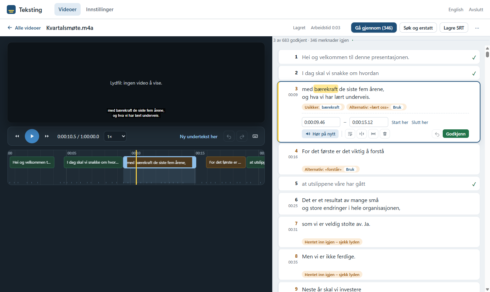

# Teksting

Norwegian subtitles for video, made and proofread on your own Windows PC.

Teksting transcribes Norwegian speech with [NB-Whisper](https://huggingface.co/NbAiLab) (the National Library of
Norway's Whisper models), splits it into subtitles that follow Netflix-style rules, and gives you an editor to
proofread them against the video. The result is an `.srt` file next to the video. Everything runs locally:
no video or audio leaves the machine.



## What it does

- **Transcription queue.** Add any number of videos; they are transcribed one at a time in the background,
  shortest first, so the first ones are ready to proofread while the long ones run.
- **Accuracy first.** The large model (beam search, word timestamps), a second pass that re-listens to stretches
  with sound but no text, and an optional double-check with a smaller model that flags where the two disagree.
- **Subtitle rules.** Max 2 lines of 42 characters, 1–7 s on screen, max 17 characters per second, at least two
  frames between subtitles, line breaks that avoid ending on weak words. All adjustable in the settings.
- **Proofreading editor.** It only shows you what needs a look: words the model was unsure of, spelling, places
  where the models disagree, rule breaks. Replay a subtitle or Ctrl+click a single word to hear it, see the word
  being spoken highlighted, approve with Enter and move on. Keyboard shortcuts for everything.
- **Learns from your corrections.** A correction made in two videos is applied automatically to new ones.
- **Measures itself.** Work time per video minute, against a goal of under 6 minutes of work per minute of video.

## Running it

Windows 10/11, a reasonably recent CPU (no GPU needed) and about 10 GB of free disk space for Python and the
speech models.

**As a user:** double-click `start.bat`. The first start installs [uv](https://docs.astral.sh/uv/), Python 3.12
and the packages into `runtime\` (a few minutes), then creates a "Teksting" shortcut on the desktop and in the
Start menu. After that, start it from the shortcut. The first video downloads the speech model (6.2 GB).
The user guide is in Norwegian: [`LES MEG.txt`](LES%20MEG.txt).

**As a developer:**

```bat
:: real models (http://127.0.0.1:8765)
runtime\python\cpython-3.12*\python.exe server.py

:: fake transcription, no models needed, separate data folder (http://127.0.0.1:8766)
dev\run_fake.bat

:: tests
dev\test.bat
```

Without `start.bat`: `pip install -r requirements.txt -r requirements-dev.txt` into a Python 3.12, then
`python server.py` and `pytest`. It is built and tested on Windows only.

Useful environment variables: `TEKSTING_FAKE=1` (fake transcription), `TEKSTING_DATA` (data folder, default
`data\`), `TEKSTING_PORT` (default 8765), `TEKSTING_NO_BROWSER=1` (no window).

## How it's built

A small Python backend and a plain JavaScript front end, with no build step and no database.

| Part | |
|---|---|
| `server.py` | FastAPI app: the API, the transcription queue (`Worker`), the burn-in queue (`Exporter`), progress and time estimates, the app window |
| `tekst/engine.py` | Model download and transcription with [faster-whisper](https://github.com/SYSTRAN/faster-whisper), the re-listening pass, waveform data |
| `tekst/segment.py` | Words with timings → subtitles: filler removal, dynamic-programming segmentation with break costs, line splitting, timing rules, SRT output |
| `tekst/compare.py` | Where the main and the fast model disagree |
| `tekst/learn.py` | Learning word corrections across videos |
| `tekst/spell.py` | Norwegian spell check (LibreOffice dictionaries via [spylls](https://github.com/zverok/spylls)) |
| `tekst/store.py` | Projects, settings and glossary as JSON files under `data\` |
| `tekst/burn.py` | Optional burned-in subtitles (Pillow + ffmpeg), hidden by default |
| `tekst/launch.py` | The app window ([pywebview](https://pywebview.flowrl.com/) on WebView2) with its loading screen |
| `static/` | The single-page front end: `app.js` (video list, settings), `editor.js` (the editor), `i18n.js` (Norwegian and English), `style.css` |
| `tests/` | pytest suite: segmentation and SRT format, learning, comparison, storage, and the API end to end in fake mode |

`dev\pack.ps1` builds the zip that is handed to users (code only, without `data\` and `runtime\`).

## Tests

```bat
dev\test.bat
```

Runs the pytest suite with the app's own Python; pytest and httpx are fetched by uv and not installed into the
app. The API tests use fake transcription, so they need no speech model and finish in a few seconds.

## Credits

Speech models: [NB-Whisper](https://huggingface.co/NbAiLab) by the National Library of Norway (Apache 2.0).
Spell checking: the Norwegian dictionaries from [LibreOffice](https://github.com/LibreOffice/dictionaries).
